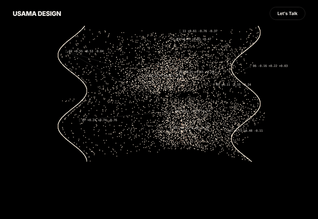

<div align="center">

# Particle Portrait Hero

**An interactive hero section where a portrait is made of thousands of particles that scatter around your cursor.**

[Live demo](https://tanoliusama249-star.github.io/particle-portrait-hero/) · [Report a bug](https://github.com/tanoliusama249-star/particle-portrait-hero/issues)



</div>

---

## How it works

1. **Sample the photo.** The image is drawn to a hidden canvas and its pixels are read.
2. **Make particles.** Every 2nd non-dark pixel becomes a particle with a "home" position, and dropping the darkest pixels removes the background.
3. **Animate each frame.** The cursor pushes nearby particles away, a spring pulls them home, and displaced particles glow warm white.
4. **HUD layer.** Floating coordinate labels, joined by thin lines, drift with a little parallax and their values change over time.

Rendering writes straight into `ImageData`, so it stays smooth with tens of thousands of particles. It works with touch too.

## Use it in your site

Copy the `<canvas id="portrait">`, the CSS and the `<script>` from `index.html`, then point `IMAGE_SRC` at your own photo. A photo on a dark background works best.

```js
const CONFIG = {
  gap: 2,           // space between particles (lower = more detail)
  size: 2,          // particle size in px
  mouseRadius: 60,  // cursor reach
  force: 3.5,       // push strength
  spring: 0.035,    // return speed (lower = smokier trail)
  friction: 0.9,
  threshold: 14,    // background cut-off
  boost: 1.5        // brightness
};
```

## Built with


No libraries and no build step: one HTML file.

---

<div align="center">Designed &amp; built by <a href="https://github.com/tanoliusama249-star">Usama</a></div>
